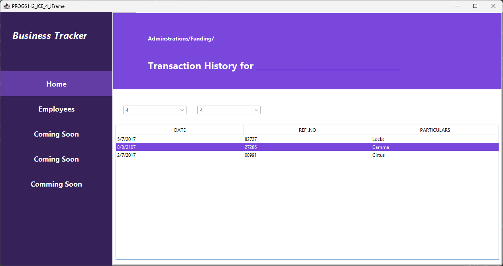
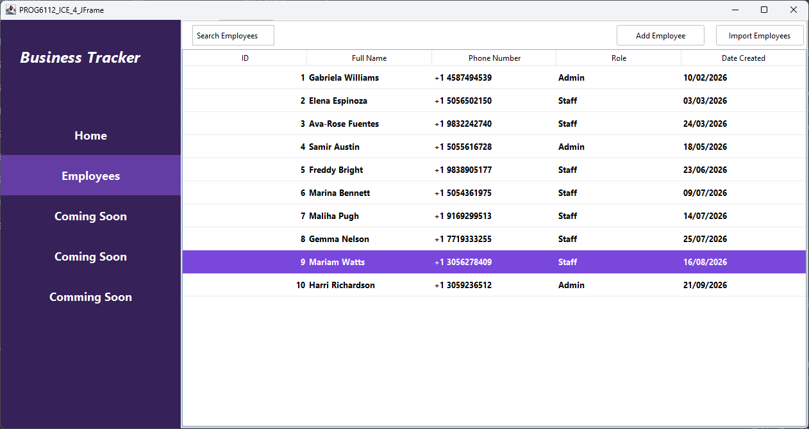

# PROG6112 ICE task 4 JFrames practice

This is a basic project designed to practice GUI design and building using Netbeans' GUI designer as such we were given an image and instructed to replicate it as best as possible, as such this project isn't functional as it only showcases the GUI design however there are 2 tabs that can be switched to using the side buttons.

The program uses multiple panels and a JtabbedPanel to organize the content with the side panel containing 5 toggle buttons grouped together using a button group, 2 of these buttons (Home and employees) can be selected/clicked in order to change the tabbedPanel's content.

# Home Panel

# Employees Panel

# Installation/Usage

This project made use of Apache Netbeans' GUI designer as such it will likely require Apache Netbeans to compile and run

Simply download the project and open the project in Apache Netbeans.
